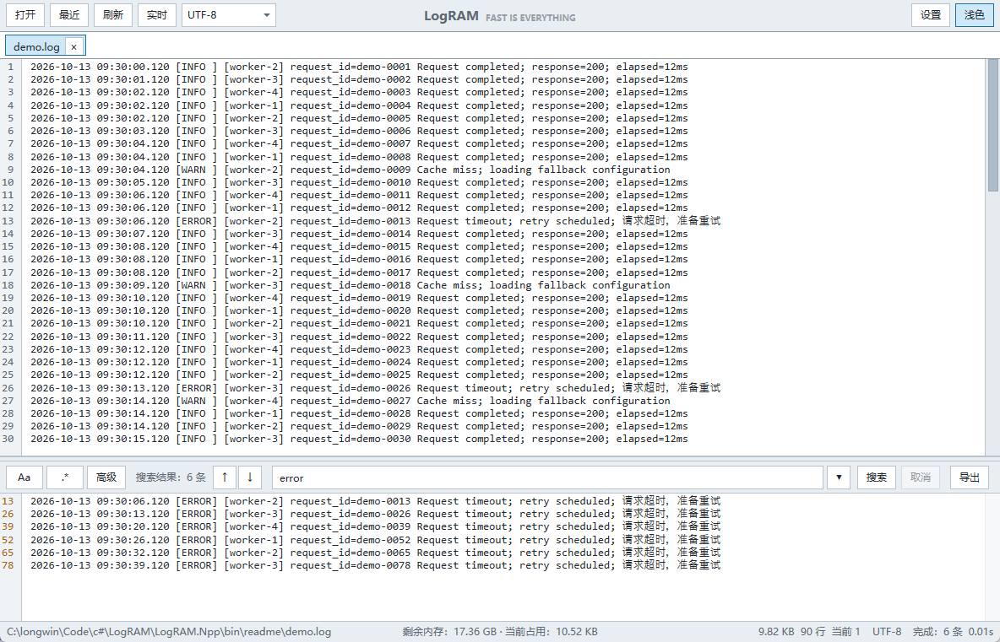
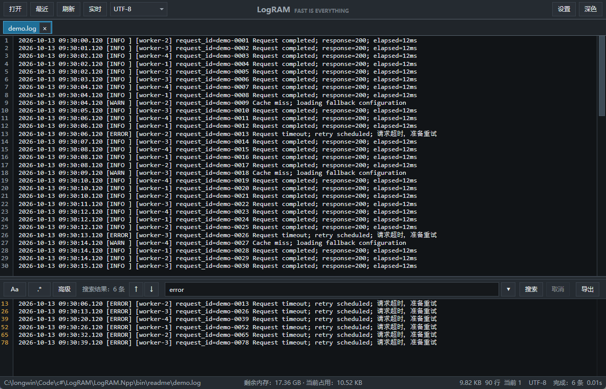
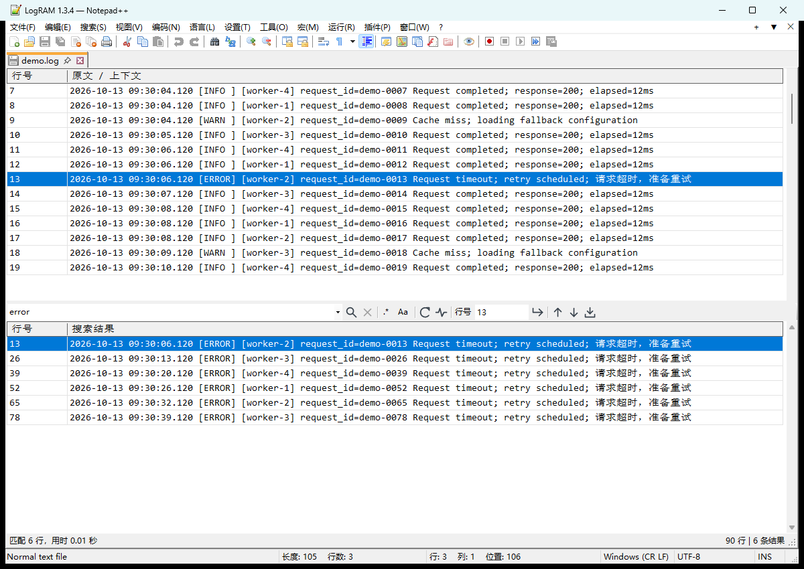
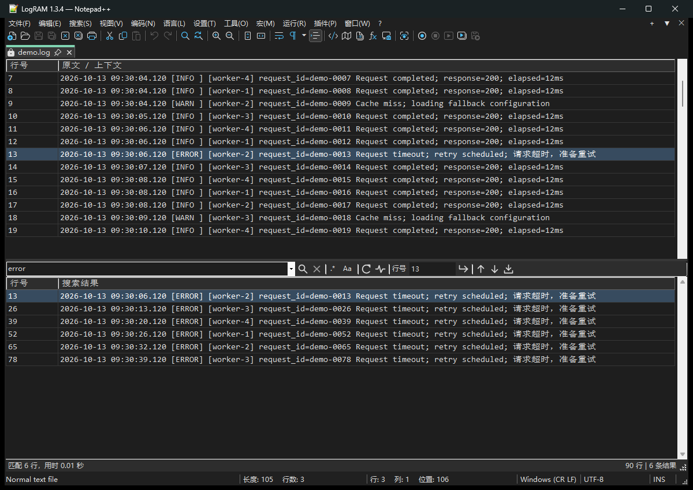

<div align="center">


# LogRAM

A large-file log viewer and search tool for Windows.

[简体中文](README.md) | English

</div>

LogRAM loads logs fully into memory and uses byte-level search, SIMD, multi-core processing, and virtualized rendering to handle large files. It is designed for multi-gigabyte logs that ordinary text editors struggle to open. The standalone GUI, Notepad++ plugin, command-line tool, and MCP server share the same search engine.

Latest release: [Notepad++ plugin 1.3.4](https://github.com/HBZHSN/LogRAM/releases/tag/npp-1.3.4). Standalone GUI, CLI, and MCP downloads are available in [release 1.3.0](https://github.com/HBZHSN/LogRAM/releases/tag/1.3.0).

| Mode | Use case | Start here |
| --- | --- | --- |
| Notepad++ plugin | Open large logs, filter results, and inspect context inside NPP | [Installation and usage](#notepad-plugin) |
| Standalone GUI | Browse multiple logs, follow live output, and search interactively | [Download](#installation-and-downloads) · [Usage](#gui-usage) |
| CLI | Terminal queries, batch processing, counts, and JSON output | [Command line](#command-line) |
| MCP | Repeated log searches and bounded reads from AI clients | [MCP server](#mcp-server) |

<div align="center">




</div>

## Features

- Open and search large log files; the standalone GUI checks available memory before loading.
- Browse multiple files in tabs; files opened again from Explorer are forwarded to the existing window.
- Search with plain text, regular expressions, case sensitivity, and include/exclude conditions.
- Stream and cancel search results, jump to the source line, and export results.
- Refresh files manually or follow appended content in real time.
- Read UTF-8 and GBK files.
- Recent files, search history, line-number navigation, and result context.
- Dark and light themes, with Simplified Chinese and English interfaces.
- GUI, command-line tool, and stdio MCP server.
- A read-only Notepad++ plugin that automatically loads `.log` files into its source/results workspace; see [plugin installation and build instructions](LogRAM.Npp/README.md).

## Requirements

- Windows 10 1809 (build 17763) or later
- Standalone source supports x64, x86, or ARM64; published standalone GUI packages are x64
- The NPP plugin requires Notepad++ 8.9.8.1 or later and offers x64/x86 packages matching the host architecture
- Enough free memory for the log file and its line index

Each open file is loaded fully into memory, so memory use accumulates across tabs. Allow additional memory for line indexes and match results; use x64 for multi-GB logs.

## Installation and Downloads

The current **Notepad++ plugin version is 1.3.4**. Its packages include the .NET 8 runtime:

| File | Download | Installation |
| --- | --- | --- |
| `LogRAM.Npp-1.3.4-x64.zip` | [Download x64](https://github.com/HBZHSN/LogRAM/releases/download/npp-1.3.4/LogRAM.Npp-1.3.4-x64.zip) | Manual installation; recommended for multi-GB logs |
| `LogRAM.Npp-1.3.4-x86.zip` | [Download x86](https://github.com/HBZHSN/LogRAM/releases/download/npp-1.3.4/LogRAM.Npp-1.3.4-x86.zip) | For 32-bit NPP |
| `*-plugin-admin.zip` | [Release page](https://github.com/HBZHSN/LogRAM/releases/tag/npp-1.3.4) | Plugins Admin layout; for manual use, extract into `plugins/LogRAM.Npp/` |

The current standalone GUI, CLI, and MCP release is **1.3.0**:

| File | Runtime | Recommended for |
| --- | --- | --- |
| [LogRAM-win-x64.exe](https://github.com/HBZHSN/LogRAM/releases/download/1.3.0/LogRAM-win-x64.exe) | .NET runtime included | Most users; runs directly after download |
| [LogRAM-win-x64-fd.exe](https://github.com/HBZHSN/LogRAM/releases/download/1.3.0/LogRAM-win-x64-fd.exe) | Requires [.NET 8 Desktop Runtime](https://dotnet.microsoft.com/download/dotnet/8.0) | A smaller download |
| [LogRAM-cli.exe](https://github.com/HBZHSN/LogRAM/releases/download/1.3.0/LogRAM-cli.exe) | Self-contained package | Terminal queries and batch processing |
| [LogRAM-mcp.exe](https://github.com/HBZHSN/LogRAM/releases/download/1.3.0/LogRAM-mcp.exe) | Self-contained package | stdio MCP integration |

LogRAM is a portable single-file application and does not require installation.

## Notepad++ Plugin

1. Check NPP's architecture and download the matching x64 or x86 manual-install archive.
2. Close NPP and copy the entire `LogRAM.Npp` folder from the ZIP into NPP's `plugins` directory. Overwrite the existing plugin folder when upgrading.
3. Restart NPP. Opening `.log` / `.LOG` files through its Open command, recent files, or file tabs automatically displays the LogRAM workspace.

```text
Notepad++/plugins/LogRAM.Npp/
  LogRAM.Npp.dll
  LogRAM.Npp.Viewer.exe
  ...supporting DLLs, runtime and license files
```

The upper pane displays the source and context; the lower pane displays search results. Its toolbar groups search, search options, refresh/live, line navigation, and result navigation/export on one row. Hover over an icon for its description; `.*` and `Aa` control regex and case sensitivity.

<div align="center">




</div>

LogRAM loads `.log` content directly into its worker's memory; NPP's editor holds only a short read-only notice. Use NPP's open/close commands, tabs and recent files. Choose UTF-8 or Character sets → Chinese → GB2312 from NPP's Encoding menu. `Ctrl+Alt+L` switches between LogRAM and the regular editor, and can be remapped in NPP's Shortcut Mapper.

| Shortcut | Plugin action |
| --- | --- |
| `Ctrl+O` / `Ctrl+W` / `Ctrl+N` | NPP open / close / new |
| `Ctrl+Tab` / `Ctrl+Shift+Tab` | Switch NPP tabs |
| `Ctrl+F` / `Ctrl+G` | Focus search / go to line |
| `F3` / `Shift+F3` | Next / previous result |
| `Esc` | Cancel the current operation |

[Official plugin-list PR #1220](https://github.com/notepad-plus-plus/nppPluginList/pull/1220) has been submitted. Plugins Admin availability requires maintainer approval and an updated official list; use the manual-install archives in the meantime.

See [plugin documentation](LogRAM.Npp/README.md) for detailed behavior and memory limits, and the [validation record](LogRAM.Npp/VALIDATION.md) for test evidence. Screenshots use a generated demo log.

## GUI Usage

1. Click **Open** and select a log file.
2. Choose UTF-8 or GBK to match the file encoding.
3. Enter a search term and press Enter; enable regex, case sensitivity, or advanced search when needed.
4. Click a result to jump to its source line. **Refresh** reloads the file, while **Live** follows appended content.

Keyboard shortcuts:

| Shortcut | Action |
| --- | --- |
| `Ctrl+F` | Focus the search box |
| `Ctrl+G` | Go to a line number |
| `F3` / `Shift+F3` | Next / previous result |

Advanced search supports "include any" and "exclude any" terms, or the equivalent syntax:

```text
in(error,warning);notin(retry,ignored)
```

## Command Line

`LogRAM-cli` uses the same search engine as the GUI and supports OR, AND, NOT, regex, line ranges, context, result limits, and JSON output.

```powershell
# Match error or warning, require orderId=42, and exclude retry
LogRAM-cli.exe app.log --any error --any warning --all orderId=42 --exclude retry --context 3 --max-count 100 --json

# Search a line range and print only the match count
LogRAM-cli.exe app.log timeout --start-line 100000 --end-line 200000 --count-only
```

Run `LogRAM-cli.exe --help` for all options.

## MCP Server

`LogRAM-mcp` is a stdio MCP server for AI clients. A log is loaded on first use and reused while the MCP process remains alive, making repeated searches and bounded reads of the same large file efficient.

Available tools:

- `search_log`: search with multiple conditions, regex, line ranges, and context.
- `read_log`: read a bounded range of lines.
- `list_open_logs`: list cached files and memory use.
- `close_log`: release one or all cached logs.

Publish and install:

```powershell
dotnet publish LogRAM-mcp/LogRAM-mcp.csproj -c Release -p:PublishProfile=win-x64
.\scripts\install-mcp.ps1 -ConfigureCodex
```

Or configure the published executable in another MCP client:

```json
{
  "mcpServers": {
    "logram": {
      "command": "C:\\path\\to\\LogRAM-mcp.exe"
    }
  }
}
```

## Build from Source

Requires the [.NET 8 SDK](https://dotnet.microsoft.com/download/dotnet/8.0).

The NPP plugin also needs CMake and a C++ compiler: MinGW-w64 for x64, or Visual Studio C++ tools for x86/ARM64. The default self-contained package includes its runtime:

```powershell
.\scripts\build-npp.ps1 -Architecture x64
.\scripts\install-npp.ps1 -NotepadDirectory 'C:\Program Files\Notepad++' -Architecture x64
```

```powershell
# Run the GUI
dotnet run --project LogRAM/LogRAM.csproj

# Run the CLI
dotnet run --project LogRAM-cli/LogRAM-cli.csproj -- app.log error

# Publish the self-contained GUI
dotnet publish LogRAM/LogRAM.csproj -c Release -p:PublishProfile=win-x64

# Publish the framework-dependent GUI
dotnet publish LogRAM/LogRAM.csproj -c Release -p:PublishProfile=win-x64-fd

# Publish the MCP server
dotnet publish LogRAM-mcp/LogRAM-mcp.csproj -c Release -p:PublishProfile=win-x64
```

## Limitations

- Windows only and read-only; LogRAM does not edit files.
- Every file is loaded fully into memory.
- Only UTF-8 and GBK are currently supported.
- The fast case-insensitive path is ASCII-only; non-ASCII text uses a slower decoded path.
- Large files need an initial line-indexing pass when opened.

## License

This project is licensed under the [MIT License](LICENSE).
