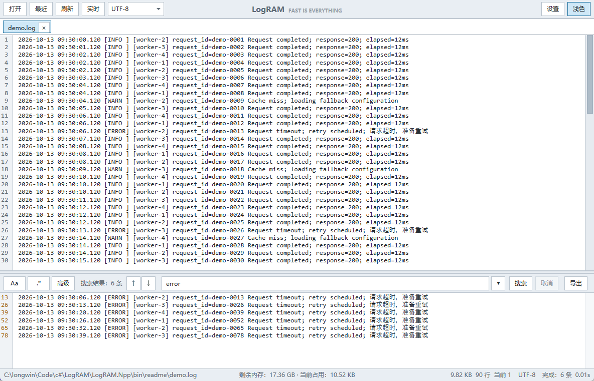
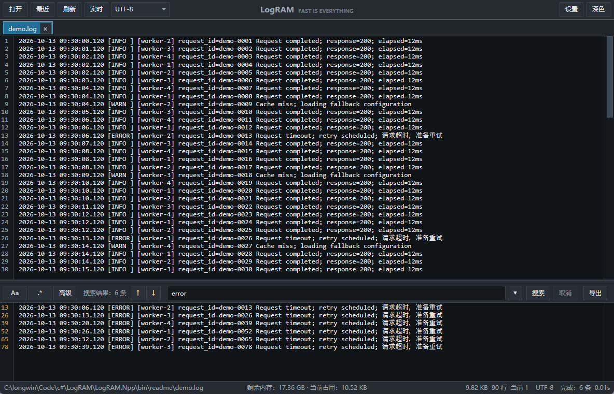
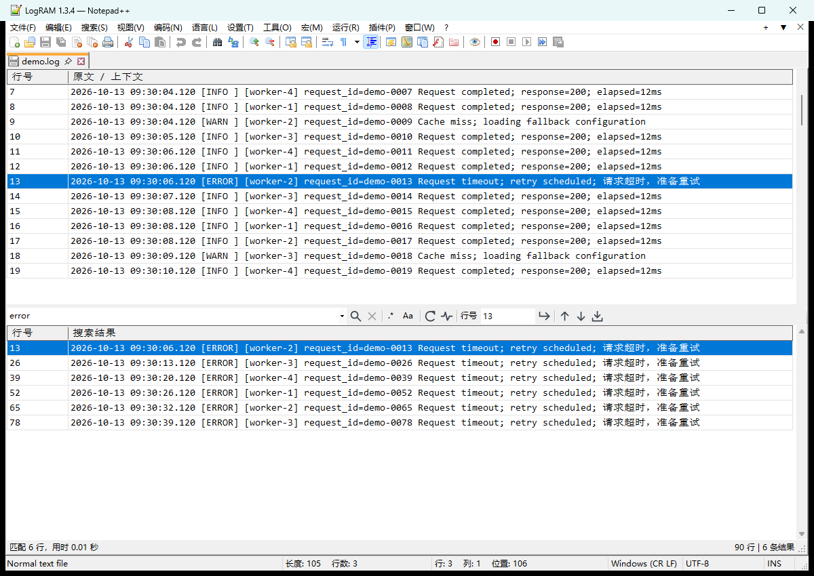
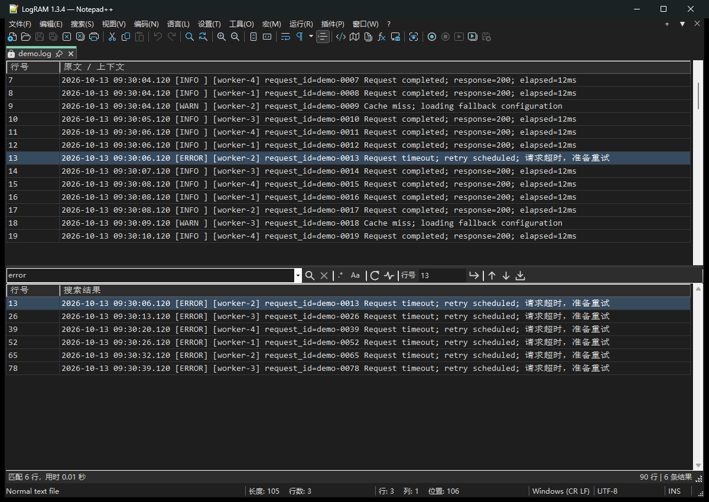

<div align="center">


# LogRAM

一个面向 Windows 的大文件日志查看与搜索工具。

简体中文 | [English](README.en.md)

</div>

LogRAM 将日志完整加载到内存，并使用字节级搜索、SIMD、多核并行和虚拟化渲染处理大文件。它适合查看普通文本编辑器难以打开的数 GB 日志，提供独立 GUI、Notepad++ 插件、命令行工具和 MCP 服务四种使用方式，共用同一搜索引擎。

最新发布：[LogRAM 1.4.0](https://github.com/HBZHSN/LogRAM/releases/tag/1.4.0) 与 [Notepad++ 插件 1.4.0](https://github.com/HBZHSN/LogRAM/releases/tag/npp-1.4.0)。

| 使用方式 | 适合的场景 | 入口 |
| --- | --- | --- |
| Notepad++ 插件 | 在 NPP 中打开大日志、筛选结果和查看上下文 | [安装与使用](#notepad-插件) |
| 独立 GUI | 多标签查看日志、实时跟随和交互搜索 | [下载](#安装与下载) · [使用](#gui-使用) |
| CLI | 终端查询、批处理、结果计数和 JSON 输出 | [命令行](#命令行) |
| MCP | AI 客户端反复查询日志并按行读取内容 | [MCP 服务](#mcp-服务) |

<div align="center">




</div>

## 主要功能

- 打开并搜索大型日志文件；独立 GUI 在加载前检查可用内存。
- 多标签页浏览，并将资源管理器中再次打开的文件转交给现有窗口。
- 支持纯文本、正则表达式、区分大小写和包含/排除组合搜索。
- 搜索结果流式显示，可取消、跳转到原文并导出。
- 支持刷新文件和实时读取追加内容。
- 支持 UTF-8 和 GBK 编码。
- 独立 GUI 与 Notepad++ 插件均可通过 SSH 浏览 Linux 远程日志；索引、搜索和刷新在远程执行，只回传当前页和有限的匹配内容。
- 提供最近文件、搜索历史、行号跳转和结果上下文。
- 支持深色/浅色主题，以及简体中文/英文界面。
- 提供 GUI、命令行工具和 stdio MCP 服务。
- 提供 Notepad++ 只读日志插件，默认接管 `.log` 的加载并显示上下两栏工作区，复用同一搜索引擎。

## 系统要求

- Windows 10 1809（build 17763）或更高版本
- 独立程序源码支持 x64、x86 或 ARM64；现有独立 GUI 发行包为 x64
- Notepad++ 插件需要 NPP 8.9.8.1 或更高版本，提供 x64 / x86 包，与 NPP 架构一致
- 足够容纳日志文件及行索引的可用内存

LogRAM 会把每个已打开文件完整加载到内存，因此多标签页的内存占用会累加。除正文外，还需为行索引和匹配结果预留内存；数 GB 日志建议使用 x64。

## 安装与下载

Notepad++ 插件当前版本为 **1.4.0**，包内包含 .NET 8 运行时：

| 文件 | 下载 | 安装方式 |
| --- | --- | --- |
| `LogRAM.Npp-1.4.0-x64.zip` | [x64 下载](https://github.com/HBZHSN/LogRAM/releases/download/npp-1.4.0/LogRAM.Npp-1.4.0-x64.zip) | 手动安装，数 GB 日志建议选择 x64 |
| `LogRAM.Npp-1.4.0-x86.zip` | [x86 下载](https://github.com/HBZHSN/LogRAM/releases/download/npp-1.4.0/LogRAM.Npp-1.4.0-x86.zip) | 用于 32 位 NPP |
| `*-plugin-admin.zip` | [发行页](https://github.com/HBZHSN/LogRAM/releases/tag/npp-1.4.0) | Plugins Admin 专用结构；手动使用时解压到 `plugins/LogRAM.Npp/` |

独立 GUI、CLI 和 MCP 当前发行版本为 **1.4.0**：

| 文件 | 运行环境 | 适用场景 |
| --- | --- | --- |
| [LogRAM-win-x64.exe](https://github.com/HBZHSN/LogRAM/releases/download/1.4.0/LogRAM-win-x64.exe) | 已包含 .NET 运行时 | 推荐，大多数电脑下载后可直接运行 |
| [LogRAM-win-x64-fd.exe](https://github.com/HBZHSN/LogRAM/releases/download/1.4.0/LogRAM-win-x64-fd.exe) | 需要 [.NET 8 Desktop Runtime](https://dotnet.microsoft.com/download/dotnet/8.0) | 文件更小 |
| [LogRAM-cli.exe](https://github.com/HBZHSN/LogRAM/releases/download/1.4.0/LogRAM-cli.exe) | 自包含发行包 | 命令行查询与批处理 |
| [LogRAM-mcp.exe](https://github.com/HBZHSN/LogRAM/releases/download/1.4.0/LogRAM-mcp.exe) | 自包含发行包 | stdio MCP 客户端集成 |

LogRAM 是免安装的单文件程序，下载后直接运行即可。

## Notepad++ 插件

1. 查看 NPP 的架构，下载对应的 x64 或 x86 手动安装包。
2. 关闭 NPP，将 ZIP 中整个 `LogRAM.Npp` 文件夹复制到 NPP 的 `plugins` 目录；更新时覆盖原插件文件夹。
3. 重启 NPP，用自带的“文件 → 打开”、最近文件或文件标签打开 `.log` / `.LOG`，自动显示 LogRAM 工作区。

```text
Notepad++/plugins/LogRAM.Npp/
  LogRAM.Npp.dll
  LogRAM.Npp.Viewer.exe
  ...配套 DLL、运行时与许可证文件
```

上栏显示原文与上下文，下栏显示搜索结果。搜索框位于下栏顶部，操作分为搜索、搜索选项、刷新 / 实时 / SSH、行号跳转、结果导航 / 导出五组；悬停显示操作说明，`.*`、`Aa` 与 `SSH` 分别控制正则、大小写和远程日志打开，也可从 **Plugins → LogRAM → Open SSH log...** 打开远程日志。

<div align="center">




</div>

`.log` 正文直接由 LogRAM 后台载入内存，NPP 编辑器只保留简短的只读提示。文件打开、关闭、标签切换和最近文件使用 NPP；编码通过 NPP 的 UTF-8 或 Character sets → Chinese → GB2312 菜单选择。`Ctrl+Alt+L` 切换 LogRAM / 普通编辑区，快捷键可在 NPP Shortcut Mapper 中修改。

| 快捷键 | 插件内的功能 |
| --- | --- |
| `Ctrl+O` / `Ctrl+W` / `Ctrl+N` | 调用 NPP 打开 / 关闭 / 新建 |
| `Ctrl+Tab` / `Ctrl+Shift+Tab` | 切换 NPP 标签 |
| `Ctrl+F` / `Ctrl+G` | 聚焦搜索 / 行号跳转 |
| `F3` / `Shift+F3` | 下一 / 上一结果 |
| `Esc` | 取消当前操作 |

已提交 [NPP 官方插件列表收录 PR #1220](https://github.com/notepad-plus-plus/nppPluginList/pull/1220)。维护者审核并发布列表后，才能通过 Plugins Admin 安装；当前可使用上面的手动安装包。

详细功能、内存行为与使用边界见 [插件说明](LogRAM.Npp/README.md)，测试依据见 [验证记录](LogRAM.Npp/VALIDATION.md)。本页截图均使用生成的演示日志。

## GUI 使用

1. 点击“打开”选择日志文件。
2. 根据文件编码选择 UTF-8 或 GBK。
3. 输入关键词并按 Enter；需要时启用正则、区分大小写或高级搜索。
4. 点击搜索结果可跳转到原文；“刷新”重新读取文件，“实时”持续读取追加内容。

常用快捷键：

| 快捷键 | 功能 |
| --- | --- |
| `Ctrl+F` | 聚焦搜索框 |
| `Ctrl+G` | 跳转到指定行 |
| `F3` / `Shift+F3` | 下一个 / 上一个搜索结果 |

高级搜索支持“包含任一”和“排除任一”，也可直接使用以下语法：

```text
in(error,warning);notin(retry,ignored)
```

### SSH 远程日志

1. 本机需要系统 OpenSSH 客户端，远程 Linux 需要 Python 3.7 或更高版本。
2. 在 `%USERPROFILE%\.ssh\config` 配置主机（例如 `C:\Users\A\.ssh\config`）。程序使用系统 `ssh.exe -F`，沿用端口、用户、IdentityFile、ProxyJump / ProxyCommand 等配置；主机列表也读取 `Include` 文件中的明确别名，可手动输入主机。
3. 先在终端执行 `ssh 主机别名`，核对主机指纹，并配置密钥或 ssh-agent 登录。GUI 使用非交互认证，不弹出密码或密钥口令输入框。
4. 点击独立 GUI 顶部 **SSH**，或在 Notepad++ 插件中点击工具栏 **SSH** / **Plugins → LogRAM → Open SSH log...**，选择主机，点击“连接 / 浏览”。连接后路径框支持实时前缀筛选，例如输入 `/var/log/a` 会列出 `/var/log/` 下所有以 `a` 开头的文件和目录，停止输入 250 ms 后自动刷新。双击目录进入，选中文件后点击“打开远程日志”；也可以直接输入远程完整路径后打开，`~` 表示远程用户的主目录。
5. 远程日志与本地日志可同时保留在不同标签页，支持 UTF-8 / GBK、翻页、行号跳转、文本 / 正则 / 高级搜索、刷新和实时追加。断线后可点击“刷新”重新连接；关闭标签页会释放远程文件和 SSH 进程。

程序经 SSH 将一个内置 Python 只读处理程序传到远程内存运行，无需部署服务、安装 .NET 或开放额外端口。文件和行索引都留在远程，搜索也在远程完成；不会通过 SFTP / SCP 下载完整日志，也不会在本机保存日志缓存。首次打开需要在远程扫描文件建立行索引，后续翻页仅按行读取；实时模式只检查并索引新增内容。

远程文件打开前，先使用固定大小的缓冲区预检行数和最长行，估算行索引及搜索工作内存，再分配索引；保留当前可用内存的 **20% 或 64 MiB（取较大值）**。可用量同时受 Linux 可用内存和 cgroup v1/v2 容器剩余额度约束。无法读取内存信息或预算不足时会拒绝打开并显示原因；建立索引、读取追加内容和搜索期间也会复查预算，失败时保留原有有效索引。首次打开需要预检与建立索引两次远程扫描。

底部内存状态统一居中显示“剩余内存 · 当前占用”，数值随当前标签切换：远程标签显示对应主机的可用内存和此日志处理进程的实际物理内存占用，空闲时每 2 秒刷新，主机信息显示在悬浮提示中；本地标签显示本机可用内存和整个客户端进程的物理内存占用。连接不可用时明确显示无法获取，不再将远程占用写成 0。

为控制网络流量，每次搜索显示全部命中数，但仅回传前 **1000 条 / 约 1 MiB** 内容（先达到的上限生效）；单行最多读取 **16 KiB** 并标记截断。导出仅包含已回传内容。目录列表最多显示 1000 项，其他文件可直接输入路径。远程正则使用 Python `re` 语法，每行匹配限时 2 秒，与本地 .NET 正则的扩展语法可能不同。远程标签页保留连接和行索引；失焦释放内存设置仍用于本地日志。

## 命令行

`LogRAM-cli` 使用与 GUI 相同的搜索引擎，支持 OR、AND、NOT、正则、行范围、上下文、结果上限和 JSON 输出。

```powershell
# 包含 error 或 warning，同时包含 orderId=42，并排除 retry
LogRAM-cli.exe app.log --any error --any warning --all orderId=42 --exclude retry --context 3 --max-count 100 --json

# 查询指定行范围并只输出命中数
LogRAM-cli.exe app.log timeout --start-line 100000 --end-line 200000 --count-only
```

运行 `LogRAM-cli.exe --help` 查看全部参数。

## MCP 服务

`LogRAM-mcp` 是供 AI 客户端使用的 stdio MCP 服务。日志首次查询时加载到内存，并在 MCP 进程存活期间复用，适合对同一大文件进行多次搜索和局部读取。

提供以下工具：

- `search_log`：搜索日志，支持多条件、正则、行范围和上下文。
- `read_log`：按行号读取局部内容。
- `list_open_logs`：查看已缓存文件和内存占用。
- `close_log`：释放一个或全部已缓存日志。

发布并安装：

```powershell
dotnet publish LogRAM-mcp/LogRAM-mcp.csproj -c Release -p:PublishProfile=win-x64
.\scripts\install-mcp.ps1 -ConfigureCodex
```

也可以将发布后的程序配置到其他 MCP 客户端：

```json
{
  "mcpServers": {
    "logram": {
      "command": "C:\\path\\to\\LogRAM-mcp.exe"
    }
  }
}
```

## 从源码构建

需要 [.NET 8 SDK](https://dotnet.microsoft.com/download/dotnet/8.0)。构建 Notepad++ 插件还需要 CMake，以及 MinGW-w64（x64）或 Visual Studio C++ 编译工具（x86 / ARM64）。默认自包含包包含运行时：

```powershell
.\scripts\build-npp.ps1 -Architecture x64
.\scripts\install-npp.ps1 -NotepadDirectory 'C:\Program Files\Notepad++' -Architecture x64
```

GUI、CLI 和 MCP 的运行与发布示例：

```powershell
# 运行 GUI
dotnet run --project LogRAM/LogRAM.csproj

# 运行 CLI
dotnet run --project LogRAM-cli/LogRAM-cli.csproj -- app.log error

# 发布自包含 GUI
dotnet publish LogRAM/LogRAM.csproj -c Release -p:PublishProfile=win-x64

# 发布依赖运行时的 GUI
dotnet publish LogRAM/LogRAM.csproj -c Release -p:PublishProfile=win-x64-fd

# 发布 MCP 服务
dotnet publish LogRAM-mcp/LogRAM-mcp.csproj -c Release -p:PublishProfile=win-x64
```

SSH 功能自检（测试时本机需要 Python 3；协议测试不连接业务服务器）：

```powershell
python scripts/test_ssh_agent.py
dotnet run --project LogRAM-cli/LogRAM-cli.csproj -- --ssh-self-test
.\LogRAM\bin\x64\Release\net8.0-windows\LogRAM.exe --ssh-ui-self-test .\LogRAM\bin\ssh-ui-test
```

## 限制

- 仅支持 Windows，且只能查看日志，不能编辑。
- 本地文件会完整载入内存；SSH 远程文件只在远程建立行索引。
- 目前只支持 UTF-8 和 GBK。
- 忽略大小写的高速搜索仅适用于 ASCII；非 ASCII 内容会使用较慢的解码路径。
- 首次打开大文件时需要建立行索引。

## 许可证

本项目采用 [MIT License](LICENSE)。
